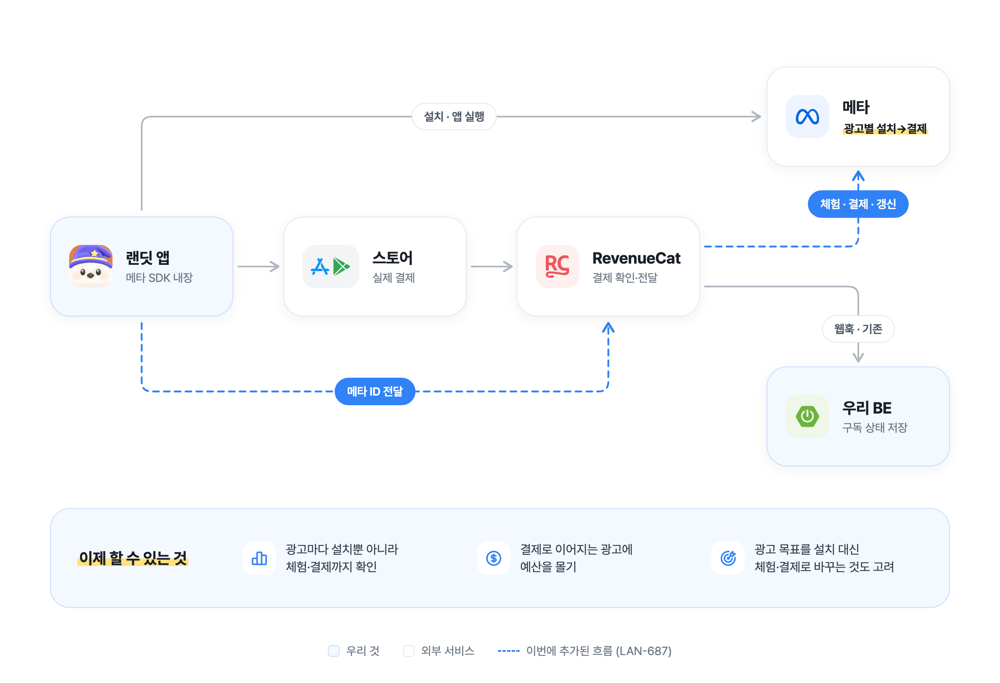
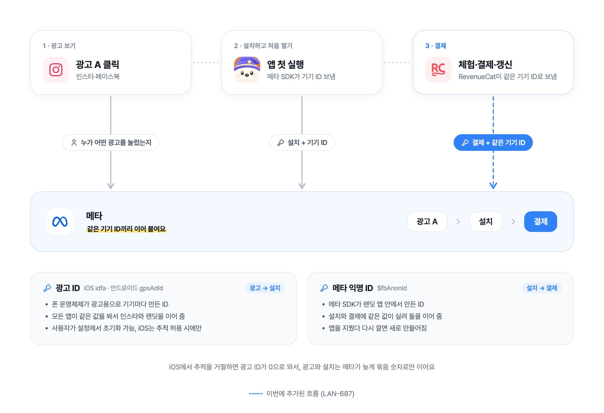
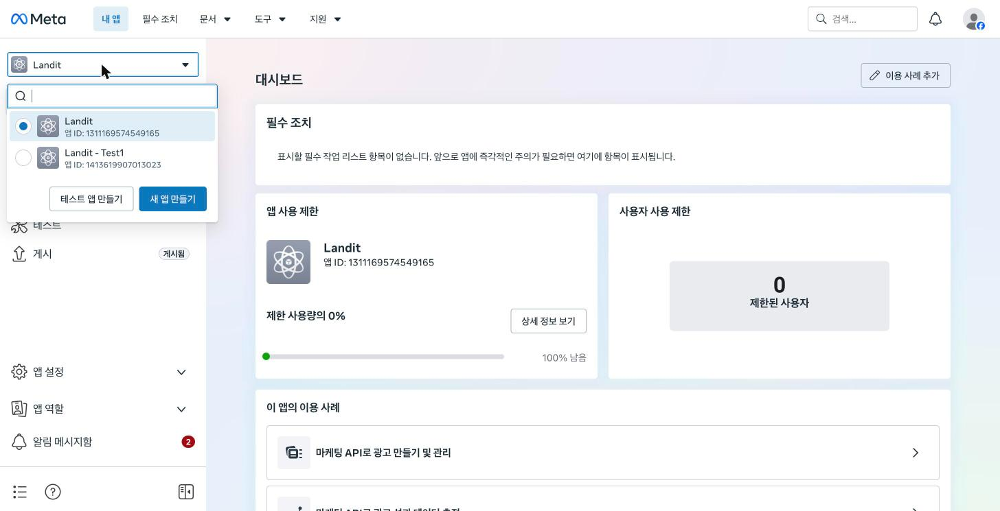
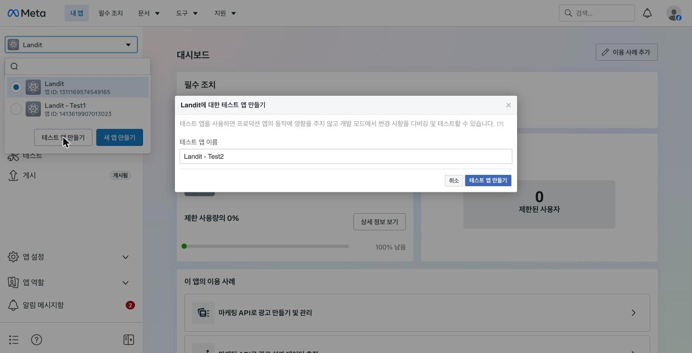
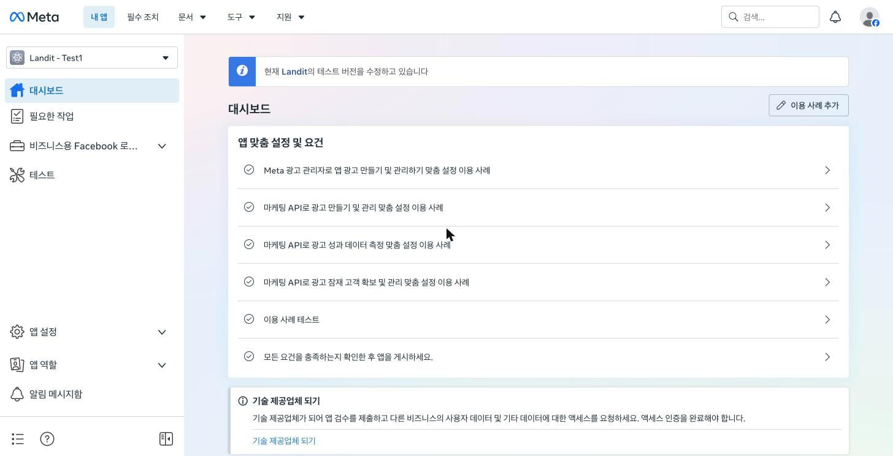
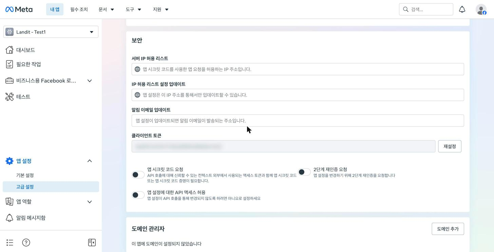

# 메타 광고 결제 측정

메타 광고 관리자에서 광고별로 설치부터 결제까지 보기 위한 구조와 테스트 방법을 정리한다 (LAN-687).

## 누가 무엇을 보내나

| 이벤트                                     | 보내는 곳             | 경로                            |
| ------------------------------------------ | --------------------- | ------------------------------- |
| 설치, 앱 실행                              | 셸의 메타 SDK         | 앱 → 메타                       |
| 체험 시작, 결제, 체험 전환, 갱신           | RevenueCat 메타 연동  | 스토어 → RevenueCat 서버 → 메타 |
| 온보딩 완료, 첫 시나리오 완료, 페이월 조회 | 웹이 알리고 셸이 기록 | 웹 → 셸의 메타 SDK → 메타       |
| 결제 시작 (Android)                        | 셸                    | 셸의 메타 SDK → 메타            |

메타는 두 경로에서 온 이벤트를 같은 기기로 묶어 광고별 숫자로 보여준다. 묶는 열쇠는 셸이 RevenueCat 사용자에 붙이는 값들이다.

- 메타 익명 ID (`$fbAnonId`)
- 광고 ID (iOS `$idfa`·`$idfv`, 안드로이드 `$gpsAdId`)와 IP

두 ID의 정체는 이렇다.

- 광고 ID: 폰 운영체제가 광고용으로 기기마다 만든 ID다. 모든 앱이 같은 값을 보므로 인스타에서 광고를 본 폰과 랜딧을 깐 폰을 메타가 같은 폰으로 맞춘다(광고 → 설치). 사용자가 설정에서 초기화할 수 있고, iOS는 추적을 허용해야 받을 수 있다. 거절하면 0이 온다. `$idfv`는 같은 개발사 앱끼리만 같은 값이라 광고 매칭보다는 보조로 쓰인다.
- 메타 익명 ID: 메타 SDK가 랜딧 앱 안에서 만든 ID다. 설치 이벤트와 RevenueCat 결제 이벤트에 같은 값이 실려 둘을 잇는다(설치 → 결제). 앱을 지웠다 다시 깔면 새로 만들어진다.

셸은 앱 시작 때 메타 SDK를 켜고, iOS는 추적 허용 결정이 끝난 뒤 이 값들을 RevenueCat에 붙인다. 로그인으로 RevenueCat 사용자가 바뀌면 새 사용자에게 다시 붙인다. 메타 SDK 초기화나 값 전달이 실패해도 결제와 앱 동작은 그대로 가고, 실패는 Sentry 경고로 남는다. 로그인 뒤 다시 붙이는 일은 결제가 기다리지 않는다. 코드는 `apps/mobile/src/analytics/meta.ts`, `apps/mobile/src/purchases/purchases.ts`.

RevenueCat은 이 값이 없는 사용자의 이벤트는 메타로 아예 보내지 않는다. App Store 결제는 `$fbAnonId`나 `$idfa`, Play 결제는 `$fbAnonId`나 `$gpsAdId`가 있어야 하고, 0으로 채워진 광고 ID는 없는 것으로 친다. 그래서 이 코드가 없는 구버전 앱 사용자의 결제는 연동을 켜도 메타에 가지 않는다.

App Events API 방식은 iOS에서 추적 허용(ATT)을 받은 사용자 이벤트만 보낸다. Conversions API 방식은 "Send events when ATT consent is not authorized"를 켜면 거절한 사용자 이벤트도 보낸다. iOS에서 추적을 거절한 사용자는 메타가 개인 단위로 잇지 못하고 늦게 묶음 숫자로만 잡으므로, 광고 관리자의 iOS 숫자는 실제보다 적다.

## 광고 최적화용 앱 이벤트

캠페인 최적화 목표로 고를 수 있게 메타 표준 이벤트 이름으로 보낸다 (LAN-768).

- 온보딩 완료 → 회원가입 완료(`fb_mobile_complete_registration`). 온보딩은 새로 가입한 사람만 거친다.
- 첫 시나리오 완료 → 튜토리얼 완료(`fb_mobile_tutorial_completion`). 한 사람에게 한 번만 간다. 서버가 이미 끝내 본 적 있다고 한 사람과 이 기기에서 그 계정으로 이미 보낸 사람은 뺀다. 서버 값은 구독 응답의 `conversationCompletedSinceLaunch`라 유료 구독 도입(9월) 전에만 끝낸 사람은 처음으로 잡힌다.
- 페이월 조회 → 콘텐츠 조회(`fb_mobile_content_view`), 콘텐츠 종류 `paywall`. 페이월이 뜰 때마다 간다.
- 결제 버튼 → 결제 시작(`fb_mobile_initiated_checkout`), 고른 패키지 id를 `fb_content_id`로 싣는다. Android만 셸이 결제 시트를 띄우기 직전에 남긴다. iOS는 메타 SDK가 스토어 결제를 보고 스스로 남겨서 같이 남기면 두 번 잡힌다.
- 결제 완료는 보내지 않는다. 위의 RevenueCat 연동이 맡는다.

대화와 페이월은 웹에서 일어나고 메타 SDK는 셸에만 있어서, 웹이 브릿지 `LOG_AD_EVENT`로 알리고 셸이 기록한다. 브릿지 12보다 옛 셸은 이 메시지를 모르니 웹이 보내지 않는다. 그래서 첫 완료는 앱을 올린 뒤 처음 끝낼 때 간다.

## 중복 주의

메타 SDK에도 결제를 자동으로 보내는 기능이 있다(메타 개발자 사이트 앱 설정 → 기본 설정 → iOS "앱 내 이벤트를 자동으로 로깅", 안드로이드 "앱 내 구매를 자동으로 로깅"). RevenueCat 연동과 같이 켜 두면 같은 결제가 두 번 잡힌다. **RevenueCat 연동을 운영 앱에 연결하는 날 이 자동 로깅을 끈다.**

## 테스트 앱으로 연동 확인하기

운영 메타 앱에 바로 연결하면 실제 사용자 결제가 그 순간부터 RevenueCat으로도 가서 중복이 생긴다. 그래서 메타 테스트 앱을 만들어 거기로 먼저 연결해 확인한다. 테스트 앱은 운영 앱의 광고·이벤트 데이터와 섞이지 않는다.

### 1. 메타 테스트 앱 만들기

메타 개발자 사이트(developers.facebook.com)에서 Landit 앱을 연다. 개발자 계정만 있으면 되고 광고 계정 권한은 필요 없다.

왼쪽 위 앱 선택 메뉴를 열고 **테스트 앱 만들기**를 누른다.

이름은 기본값(`Landit - Test1`)을 써도 된다. **테스트 앱 만들기**를 누르면 비밀번호를 다시 묻는다.

만들어지면 위에 "현재 Landit의 테스트 버전을 수정하고 있습니다"가 뜬다. 지금 쓰는 테스트 앱은 `Landit - Test1` (앱 ID `1413619907013023`)이다.

### 2. 클라이언트 토큰 찾기

테스트 앱의 **앱 설정 → 고급 설정 → 보안** 칸에 클라이언트 토큰이 있다. 토큰은 문서나 채팅에 적지 않는다.

### 3. RevenueCat에 연결하기

RevenueCat 대시보드 → Integrations → Meta Ads에서 아래처럼 넣고 **Add integration**을 누른다.

- Choose Meta API: `App Events API`
- App ID, Sandbox App ID: 테스트 앱 ID
- Client Token, Sandbox Client Token: 2번에서 찾은 토큰

크롬 자동완성이 App ID 칸에 이메일을, Client Token 칸에 저장된 비밀번호를 넣는 경우가 있다. 저장 전에 칸을 확인한다.

### 4. 샌드박스 결제로 확인하기

1. 셸 코드가 들어간 빌드(테스트플라이트 등)에서 샌드박스 계정으로 결제한다. 시뮬레이터의 StoreKit 설정 파일 결제는 RevenueCat이 검증하지 못해 이벤트가 생기지 않는다.
2. RevenueCat 고객 화면에서 Attributes에 `Facebook Anon ID`가 있는지 본다. 대시보드는 Sandbox data 토글을 켜야 보인다.
3. 고객 화면 Customer history의 결제 줄에서 View Details를 열고, Integrations 표에 `Meta App Events API`가 `Sent`로 찍히는지 본다. 웹훅보다 몇 분 늦게 찍힌다.
4. 테스트 앱의 이벤트 관리자에서 구매 이벤트가 들어오는지 본다. 메타 화면에는 최대 하루 늦게 보일 수 있다.

셸 코드가 없는 빌드로 확인해야 하면, 결제 전에 RevenueCat 고객 화면 Attributes → New로 `$fbAnonId`를 손으로 붙여도 된다. iOS는 그 사용자의 ATT Consent가 Authorized여야 한다.

## 운영으로 바꾸는 날

1. 셸 코드가 들어간 앱이 배포되어 있어야 한다.
2. RevenueCat 메타 연동의 운영 칸을 운영 메타로 바꾼다. 메타가 App Events API를 더는 관리하지 않으므로 운영은 Conversions API(운영 데이터 세트 ID와 토큰)를 권장한다. Conversions API로 바꾸면 샌드박스 칸도 데이터 세트 ID를 받으므로, 테스트 결제를 운영 데이터와 분리하려면 테스트용 데이터 세트가 따로 필요하다.
3. 같은 날 메타 SDK의 결제 자동 로깅을 끈다. iOS 결제 시작도 이 자동 기록이 남기던 것이라, 셸 `logCheckoutStarted`의 안드로이드 제한을 같이 풀어야 iOS 결제 시작이 끊기지 않는다.
4. 하루 안에 운영 이벤트 관리자에 RevenueCat 통합으로 이벤트가 들어오는지 본다.
